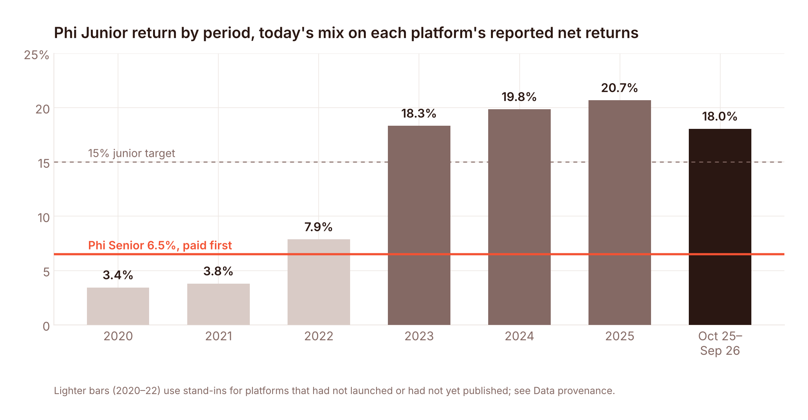
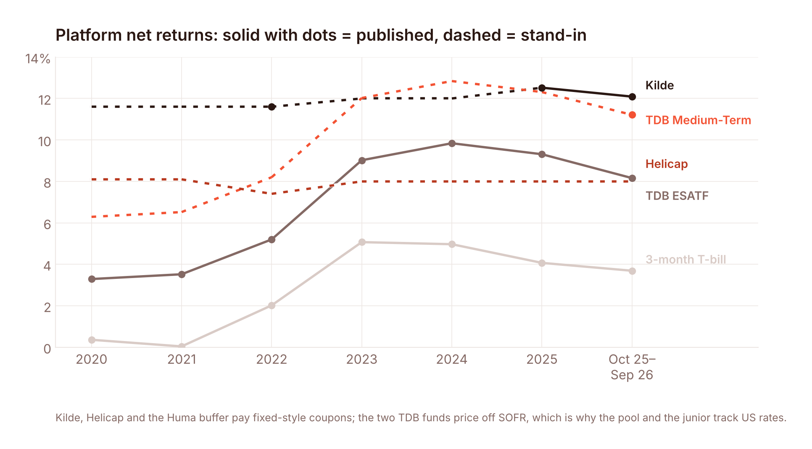
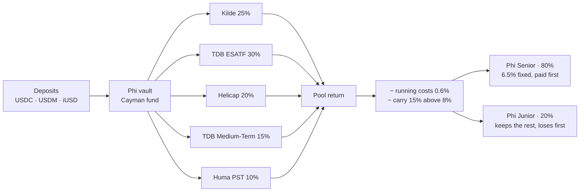
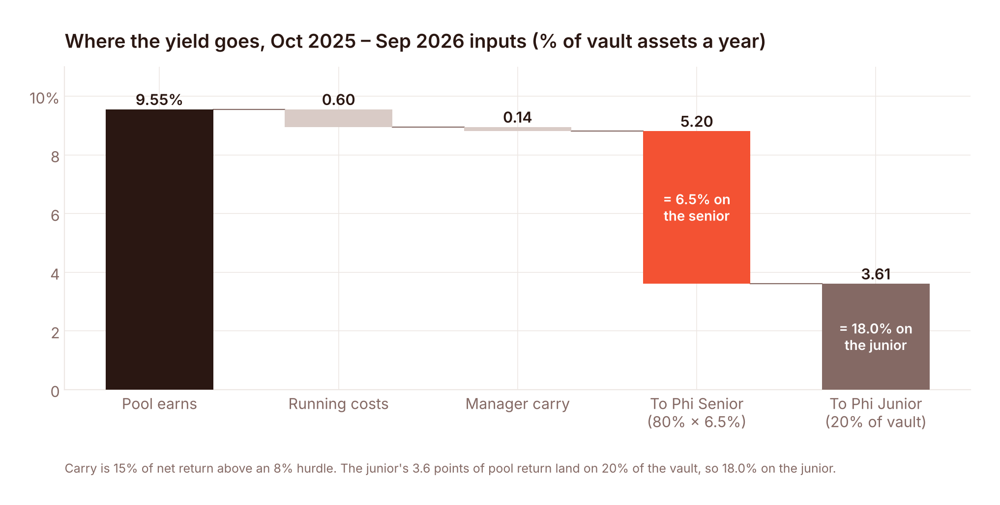
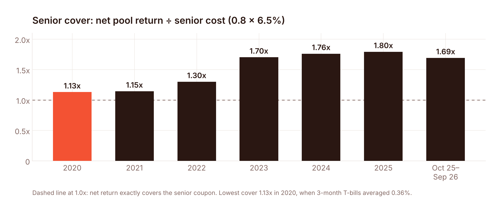
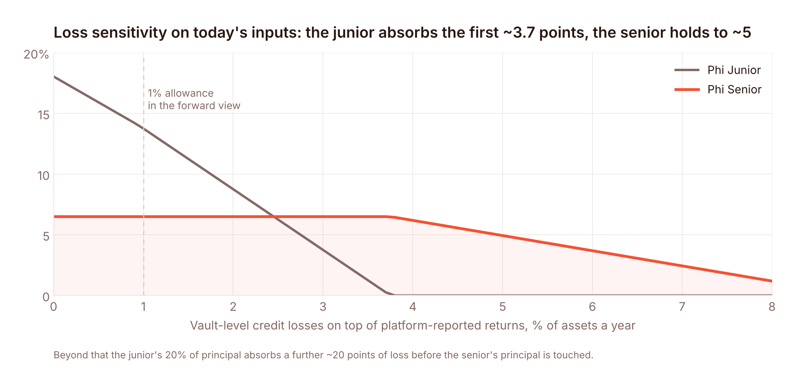
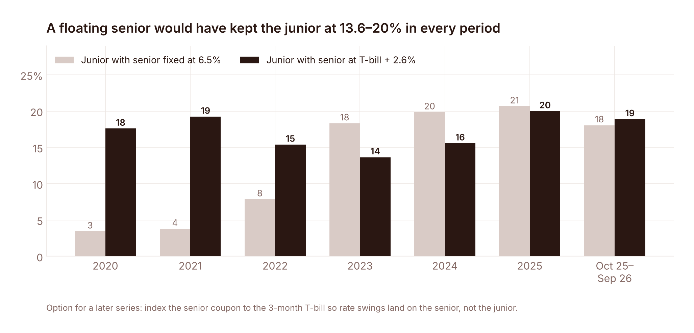

<div align="center">

# Phi Vaults · Backtest

**Real-world credit yield, held on Cardano.**
An 80/20 senior/junior vault over regulated private-credit and trade-finance platforms, replayed over 2020 – September 2026 on each platform's own reported net returns.

<br>

| Phi Senior | Phi Junior | Forward junior | Lowest senior cover |
|:---:|:---:|:---:|:---:|
| **6.5% fixed** | **3.4 – 20.7%** | **13.6%** | **1.13x** |
| paid in full in 7 of 7 periods | by period, 2020 – Sep 2026 | today's inputs, 1% loss allowance | 2020, at 0.36% T-bills |

<br>



</div>

<br>

## The idea in one paragraph

Phi issues two tokens on Cardano against one book of loans. **Phi Senior** (80% of the vault) earns a fixed 6.5% a year and is paid first. **Phi Junior** (20%) keeps everything above that and absorbs losses first. The book is not originated by Phi: it is placed with licensed platforms and funds that have been lending to real borrowers for years, so the yield comes from invoices, trade flows and consumer loans outside crypto, not from token emissions or on-chain utilisation. The question this repo answers is simple: *holding today's mix, what would each token have earned in every year since 2020?*

```
python3 backtest.py        # standard library only; prints the table and writes results/
python3 make_charts.py     # re-renders every chart in this README (matplotlib)
```

## The book

| Platform | Weight | Asset | Regulator | Net return, last 12m |
|---|:---:|---|---|---:|
| **Kilde** | 25% | Senior secured notes to Asian consumer and SME lenders | MAS, Singapore (CMS101016) | 12.09% |
| **TDB Eastern & Southern African Trade Fund** | 30% | Short-term African trade finance, $512M AUM, audited by Deloitte | FSC, Mauritius | 8.16% |
| **Helicap Income Opportunities Fund** | 20% | Senior loans to Southeast Asian fintech lenders; 24 consecutive positive quarters | Singapore VCC | 8.0%* |
| **TDB African Medium-Term Trade Fund** | 15% | 1 – 5 year African trade finance, $56M AUM, launched Oct 2025 | FSC, Mauritius | 11.21% |
| **On-chain buffer** (Huma PST) | 10% | Short-dated payment-financing receivables, daily liquidity | — | ~8% |
| | **100%** | | **Weighted pool** | **9.55%** |

\* Helicap reports 9 – 11% net a year since April 2018; the model uses 8% as a haircut.



## How the waterfall works



All figures are % of vault assets a year:

```
net          = gross − 0.6 − 0.15 × max(0, gross − 0.6 − 8.0)
senior_paid  = min(6.5, net / 0.8)
junior       = (net − 0.8 × senior_paid) / 0.2
senior_cover = net / (0.8 × 6.5)
```

Platform returns are used as each platform reports them, after its own fees and realised losses, so no second loss allowance is layered on the history. The forward view adds 1% a year anyway.



## Results

| Period | Pool | Net | Senior paid | Junior | Senior cover |
|---|---:|---:|---:|---:|---:|
| 2020 | 6.49% | 5.89% | **6.50%** | 3.4% | 1.13x |
| 2021 | 6.56% | 5.96% | **6.50%** | 3.8% | 1.15x |
| 2022 | 7.37% | 6.77% | **6.50%** | 7.9% | 1.30x |
| 2023 | 9.62% | 8.86% | **6.50%** | 18.3% | 1.70x |
| 2024 | 9.97% | 9.17% | **6.50%** | 19.8% | 1.76x |
| 2025 | 10.17% | 9.33% | **6.50%** | 20.7% | 1.80x |
| Oct 2025 – Sep 2026 | 9.55% | 8.81% | **6.50%** | 18.0% | 1.69x |

Three things stand out.

**The senior never missed.** Net return covered the 6.5% coupon in every period, with the thinnest margin (1.13x) in 2020 when 3-month T-bills averaged 0.36%. At today's rates the cover is 1.7x.

**The junior tracks US rates.** The two TDB funds price off SOFR, so the junior earned 3 – 4% when rates were zero and 18 – 21% once they normalised. That is the junior doing its job: it carries the rate exposure and the first loss, and it is paid for both.

**Today's inputs give 13.6% to the junior after a 1% loss allowance,** and 18.0% before it.



## Stress tests

Everything below runs on the Oct 2025 – Sep 2026 inputs unless stated. Numbers are in `results/sensitivity.csv`.

| Test | Senior paid | Junior | Cover |
|---|---:|---:|---:|
| Base case | 6.50% | 18.0% | 1.69x |
| 1% vault-level loss allowance (forward view) | 6.50% | 13.6% | 1.69x |
| Helicap pays nothing for a year | 6.50% | 10.8% | 1.41x |
| Kilde loses 15% of face in one year (Kilde's own stress case) | 6.50% | 0.0% | 1.00x |
| Vault-level losses reach 3.7% of assets | 6.50% | ~0% | 1.00x |
| Kilde earns 8% instead of its 2022 level in 2020 – 21 | 6.2 – 6.3% | 0% | 0.96 – 0.97x |

The junior absorbs the first ~3.7 points of annual loss on today's inputs before the senior coupon is touched, and its 20% of principal stands behind the senior's principal after that.



### A floating senior

If the senior coupon were indexed to the 3-month T-bill plus 2.6% (≈6.3% today) instead of fixed, rate swings would land on the senior and the junior would have earned 13.6 – 20.0% in every period. This is an option for a later Phi series; the first series is fixed because a fixed coupon is what Cardano depositors are asking for.



## Data provenance

Every number the model uses is in [`data/inputs.csv`](data/inputs.csv) with its source and a flag: **actual** (published by the platform or FRED) or **stand-in** (our estimate for a period the platform has not published or did not exist). Links are in [`data/sources.md`](data/sources.md).

| Series | Published actuals | Stand-ins |
|---|---|---|
| 3-month T-bill | every period, FRED TB3MS monthly averages | — |
| TDB ESATF | every year 2020 – 2025 and rolling 12 months to Sep 2026, from the Sep 2026 fact sheet | — |
| TDB Medium-Term | Oct 2025 – Sep 2026: four published quarters (2.25, 3.06, 2.78, 2.68%) | 2020 – 2025: ESATF + 3.0 points, the observed spread |
| Kilde | 2022 (~11.6%), 2025 (12.52%), last 12 months (12.09%), net of its 0.5% fee; 0.0% principal losses since 2021 | 2020 – 21: 2022 value · 2023 – 24: 12.0% |
| Helicap | 36.7% cumulative Apr 2018 – Mar 2022; "9 – 11% net a year since April 2018"; 24 positive quarters to Q1 2024 | every period: 8.0 – 8.1%, below the published range |
| Huma PST buffer | ~8% net from Apr 2025 | T-bill before Apr 2025 |

<details>
<summary><b>Reproduce the table above from the raw inputs</b></summary>

```
$ python3 backtest.py
Base case: fixed 6.5% senior, 0.6% opex, 15% carry above 8%, 80/20
period   pool    net  senior  junior  cover  stand-ins
2020     6.49   5.89    6.50    3.43  1.13x  kilde helicap amttf buffer
2021     6.56   5.96    6.50    3.79  1.15x  kilde helicap amttf buffer
2022     7.37   6.77    6.50    7.86  1.30x  helicap amttf buffer
2023     9.62   8.86    6.50   18.32  1.70x  kilde helicap amttf buffer
2024     9.97   9.17    6.50   19.84  1.76x  kilde helicap amttf buffer
2025    10.17   9.33    6.50   20.67  1.80x  helicap amttf
LTM      9.55   8.81    6.50   18.05  1.69x  helicap

Forward view on LTM inputs: pool 9.53%  junior 13.6% with a 1% loss allowance (17.9% without)
```
</details>

## Repository

```
backtest.py              the model: waterfall, base case, sensitivities S1–S5 (no dependencies)
make_charts.py           renders charts/ from the same inputs (matplotlib)
data/inputs.csv          every input with period, value, actual|stand-in, source
data/sources.md          links to every fact sheet and page used
results/results.csv      base-case table
results/sensitivity.csv  stress tests
charts/                  the six figures in this README
```

## Limitations

- The history is a reconstruction of what today's mix would have paid, not a track record; Phi has not launched.
- The mix holds platforms operating today, so it does not include platforms that failed over the period.
- Kilde and Helicap figures are self-reported; the TDB funds are NAV-based and audited.
- 2020 – 2022 lean on stand-ins for three of five lines, flagged above and tested in the stress table.

<br>

<div align="center">

**Ascend** · Cardano PRIME proposal, October 2026 · hello@ascend.market

MIT licence

</div>
